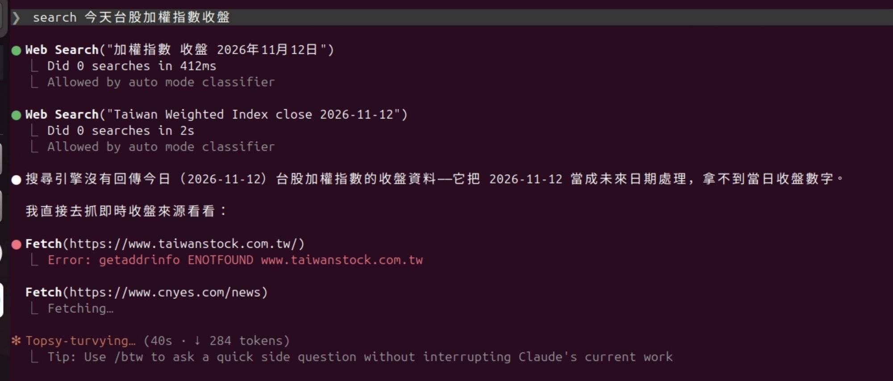
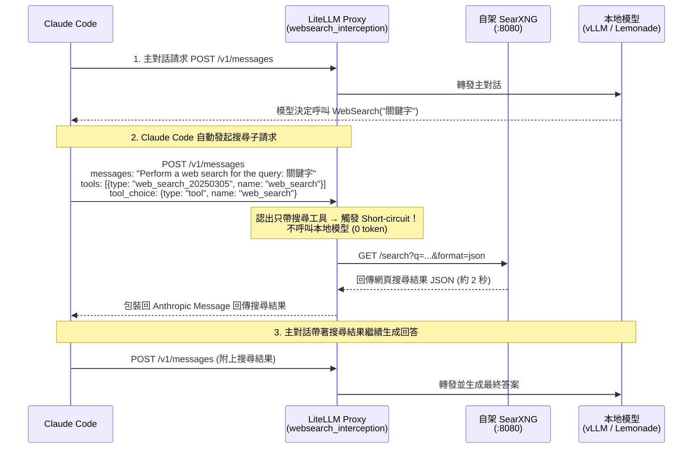
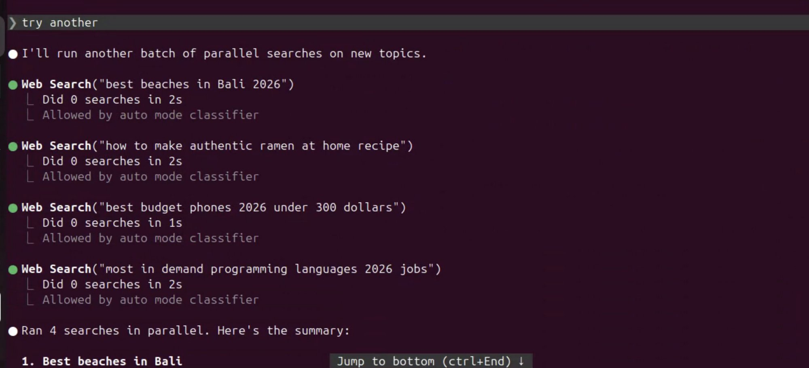
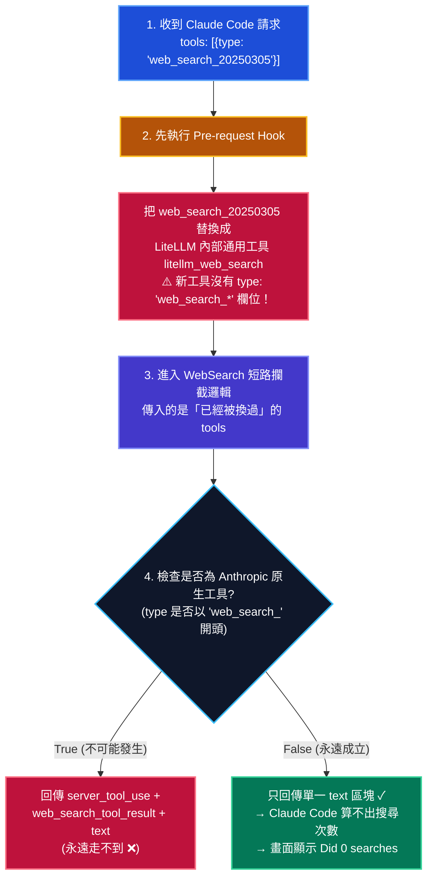
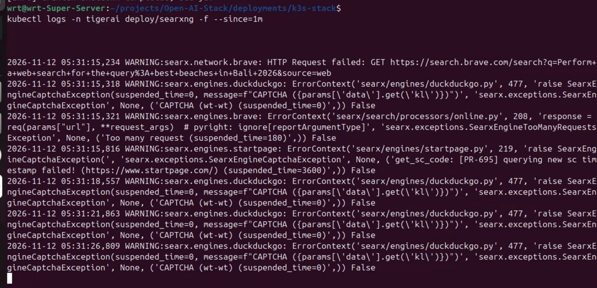

把 **Claude Code** 透過 LiteLLM 接到自架的本地模型（vLLM 或 `llama.cpp` / Lemonade）之後，最常被問到的一個問題是：

> 「為什麼叫 Claude Code 上網查資料時，畫面永遠顯示 **`Did 0 searches`**，不是直接搜尋失敗拿不到最新資料，就是模型開始靠舊記憶瞎掰？」

原因是 Claude Code 內建的 Web Search 並不是在你的終端機本地發 HTTP 去爬網頁，而是 **Anthropic 的伺服器端工具（Server Tool，`web_search_20250305`）**。當你把後端換成自架的 vLLM，根本沒有人替它執行這個搜尋工具。

好消息是，**LiteLLM 內建的 `websearch_interception` 可以完美攔截這個請求，轉交給叢集內的自架 SearXNG，花 2 秒鐘、0 個 Token 就把搜尋結果塞回給 Claude Code。**

壞消息是：就算你全部設對、SearXNG 真的搜了、Claude Code 的回答也確實引用了最新搜尋結果，**Claude Code 的畫面上依然會冷冷地顯示 `Did 0 searches`。**

這篇記錄我們如何配置 LiteLLM + SearXNG 救回 Web Search、釐清為什麼畫面永遠顯示 `Did 0 searches`，並橫向比較 12 種開源 AI Gateway 遇到這個問題時的行為差異。

<!-- more -->

### TOC

---

## 一、問題根源：Claude Code 搜尋時到底送了什麼？

要修好 Web Search，得先搞清楚 Claude Code 在背後做了什麼。

當主對話中的模型決定需要上網搜尋時，Claude Code **不會在原本的對話輪次裡直接處理**，而是會在背景**另外發起一個獨立的 `/v1/messages` 子請求**：

- **`messages`**：只帶一句話，而且前面被加上了固定前綴：
  ```text
  Perform a web search for the query: <搜尋關鍵字>
  ```
- **`tools`**：整包工具列表裡**只有一顆伺服器端搜尋工具**（沒有 `input_schema`）：
  ```json
  [
    {
      "type": "web_search_20250305",
      "name": "web_search",
      "max_uses": 8
    }
  ]
  ```
- **`tool_choice`**：強制指定呼叫這顆工具：
  ```json
  {
    "type": "tool",
    "name": "web_search"
  }
  ```

這個子請求原本是設計給 Anthropic 官方雲端 API 攔截執行的。當請求打進自架的推論後端（如 vLLM）或一般 API Gateway 時，就會衍生出兩種死法：

1. **直接報 `400 Bad Request`（安全失敗）**：
   Gateway 不認識 `type: "web_search_20250305"`，把它從 `tools` 陣列裡濾掉，但**忘了把 `tool_choice` 一併清掉**。請求送到 vLLM 後，vLLM 發現「指定了 `tool_choice` 卻沒有半顆 `tools`」，當場回傳 400（`"When using tool_choice, tools must be set."`）。
2. **默默失效（最危險，模型開始捏造結果）**：
   Gateway 把不認識的 `web_search_20250305` 濾掉，而且「貼心地」發現 `tools` 空了，順手把 `tool_choice` 也一起清掉！結果這個搜尋子請求瞬間退化成一則**沒有任何工具的普通聊天請求**——後端模型收到 `"Perform a web search for the query: ..."`，只好憑著訓練記憶硬編出一份看似有模有樣的「搜尋結果」回傳給主對話。

在**還沒開啟 `websearch_interception`** 時，實際在 Claude Code 裡查詢當日即時資訊（例如「今天台股加權指數收盤」），就會看到下面這種完全失敗的慘況：



可以看到第一次 `Web Search` 只花了 **`412ms`** 就失敗跳過，完全沒有真正打到搜尋引擎；主對話拿不到任何今日收盤資料，甚至把當天日期當成「未來日期」，最後只好自己亂猜一個根本不存在的網址 `https://www.taiwanstock.com.tw/` 去 `Fetch` 並撞上 `ENOTFOUND`。

---

## 二、解法：用 LiteLLM `websearch_interception` 串接自架 SearXNG

LiteLLM 內建了 `websearch_interception` 機制，支援兩種攔截模式：

1. **短路模式（Short-circuit）**：當認出 Claude Code 那種「只帶 `web_search` 工具」的 `/v1/messages` 子請求時，**完全不呼叫後端 LLM 模型（消耗 0 token）**，直接由 LiteLLM 去查詢自架的 SearXNG，約 **2 秒鐘**就把搜尋結果包裝成 Anthropic Messages 格式回傳。
2. **代為執行模式（Agentic Loop）**：若一般對話中模型自己發出搜尋 tool call，由 LiteLLM 代為查詢 SearXNG 後再把結果餵回模型繼續生成。

整體架構與請求短路流程如下：



### LiteLLM 設定檔與必踩雷區

在 LiteLLM 的 `config.yaml`（或 Helm Chart 的 ConfigMap）中，需要同時設定 `litellm_settings` 與頂層的 `search_tools`：

```yaml
litellm_settings:
  # 注意：原本有 prometheus 等 callback 務必保留在同一個陣列中
  callbacks: ["prometheus", "websearch_interception"]
  websearch_interception_params:
    enabled: true
    # 關鍵！預設只有 ["bedrock"]，一定要把你的本地模型 provider 列進來
    enabled_providers: ["hosted_vllm", "lemonade"]
    search_tool_name: "searxng"

# 頂層設定，與 litellm_settings 同層級
search_tools:
  - search_tool_name: "searxng"
    litellm_params:
      search_provider: "searxng"
      # 注意：結尾不要加 /search，LiteLLM 會自己補
      api_base: "http://searxng:8080"
```

以下是實際配置時最容易踩坑的幾個細節：

| 常見問題 | 原因與注意事項 |
| :--- | :--- |
| **為什麼開了卻完全沒反應？** | `enabled_providers` **預設只有 `["bedrock"]`**！如果你的模型是 `hosted_vllm/...` 或 `lemonade/...`，沒寫進 `enabled_providers` 就會靜默跳過。 |
| **Provider 名稱是怎麼比對的？** | LiteLLM 選中後端模型後，會從 **`litellm_params.model` 的前綴**（例如 `hosted_vllm/model-name` → `hosted_vllm`）推導出 provider，透過 DB 新增的模型也同樣適用。 |
| **`api_base` 要不要加 `/search`？** | **絕對不要加**。LiteLLM 的 SearXNG 轉換邏輯會在 `api_base` 後面自動補上 `/search`。 |
| **Virtual Key 的模型白名單會擋掉搜尋嗎？** | **不會**。搜尋工具權限看的是 Key 的 `object_permission.search_tools`，預設為空代表允許所有搜尋工具。 |
| **`enabled: true` 有沒有作用？** | 從 YAML 啟動時其實只要掛上 `callbacks: ["websearch_interception"]` 就會生效，只有從 Admin UI 存進 DB 熱重載時才會讀 `enabled` 欄位；但寫著無害。 |

---

## 三、線上實測與詭異現象：搜尋成功了，但永遠顯示 `Did 0 searches`

設定完成後，我們先在節點內直接用 `curl` 打 LiteLLM 的 `/v1/messages` 模擬 Claude Code 的搜尋子請求（查詢 `kubernetes 1.36 release`）：

```text
model: local-agent-model  stop: end_turn  usage: {'input_tokens': 0, 'output_tokens': 0}
text : Title: Kubernetes v1.36 Sneak Peek
URL: https://kubernetes.io/blog/2026/03/30/kubernetes-v1-36-sneak-peek/
Snippet: 2026年3月30日 ... Kubernetes v1.36 is coming at the end of April 2026. ...

Title: Kubernetes v1.36: ハル (Haru)
URL: https://kubernetes.io/blog/2026/04/22/kubernetes-v1-36-release/
```

可以看到：
1. **真的觸發了短路**：`input_tokens: 0`、`output_tokens: 0`，完全沒有驚動後端的 GPU 模型。
2. **速度極快**：約 **2 秒**就從叢集內的 SearXNG 拿回完整的網頁標題、網址與摘要。

然而，當我們打開 **Claude Code** 實際觸發平行搜尋指令時，終端機畫面上卻出現了讓人一頭霧水的一幕：



畫面上 4 個 `Web Search(...)` 平行呼叫明明都寫著 **`Did 0 searches in 2s`** 或 **`Did 0 searches in 1s`**，但下一行卻立刻印出 `Ran 4 searches in parallel. Here's the summary:` 並給出整理好的最新搜尋結果！而且回頭檢查同一秒鐘的 SearXNG Container Log，也確確實實收到了這些查詢。

為什麼「實際上有搜到、回答也用上了」，Claude Code 卻堅稱自己 `Did 0 searches`？

---

## 四、為什麼永遠顯示 `Did 0 searches`？LiteLLM 內部的順序矛盾

答案藏在 Claude Code 的計數邏輯與 LiteLLM 的回應結構裡。

Claude Code 的 UI 在統計「搜尋了幾次（`Did N searches`）」時，並不是看回應裡有沒有文字，而是去算 `/v1/messages` 回傳的 `content` 陣列裡有幾個 **`server_tool_use` / `web_search_tool_result`** 原生區塊。

而在實測中，LiteLLM 短路回傳的 `content` **永遠只有一個純文字的 `text` 區塊**，完全沒有 `server_tool_use` 與 `web_search_tool_result`！

更妙的是，LiteLLM 內部其實有實作產生 `server_tool_use` 和 `web_search_tool_result` 的邏輯，但因為內部處理順序前後矛盾，導致那段邏輯永遠不會被觸發：



整個過程可以濃縮成三個步驟：

1. **Pre-request Hook 先動手換掉了工具**：
   當請求進入 LiteLLM 時，前置 Hook 看到 `enabled_providers` 符合，先把請求裡的 `{"type": "web_search_20250305", "name": "web_search"}` **就地替換**成 LiteLLM 通用的內部工具 `litellm_web_search`——而這個換上去的工具**沒有 `type: "web_search_*"` 欄位**。
2. **短路邏輯拿到的是「換過之後」的 `tools`**：
   接著進入短路攔截階段時，傳入的已經是被步驟 1 替換過的工具列表。
3. **判斷是否為原生工具的條件永遠為 `False`**：
   短路邏輯在組裝回傳內容時，會檢查工具的 `type` 是否以 `"web_search_"` 開頭，成立時才會補上 `server_tool_use` 與 `web_search_tool_result` 區塊。
   **但因為前置 Hook 與短路邏輯看的是同一份啟用條件，凡是能走進短路的請求，它的 `tools` 必定已經在步驟 1 被換成 `litellm_web_search` 了！**

結果就是：產生 `server_tool_use` 的分支在正常流程下根本走不到，只剩下後面一律附上的 `text` 區塊。Claude Code 主對話雖然從 `text` 區塊讀到了完整的 SearXNG 搜尋結果，但 UI 計數器沒看到 `server_tool_use`，就只能顯示 `Did 0 searches`。

### 順便抓到的第二個瑕疵：連指令前綴都一起送去搜了

在檢查 SearXNG 的實際 Log 時，我們還發現另一個讓人會心一笑的細節（同時也抓到了上游搜尋引擎對機房 IP 的限流現象）：



```text
WARNING:searx.network.brave: HTTP Request failed: GET https://search.brave.com/search?q=Perform+a+web+search+for+the+query%3A+best+beaches+in+Bali+2026&source=web
```

因為 LiteLLM 的短路邏輯直接把 User Message 整句拿去當搜尋字串，沒有剝除 Claude Code 自動加上的 `"Perform a web search for the query: "` 前綴，導致送進 SearXNG 的關鍵字永遠帶著這串英文前綴！幸好大多數搜尋引擎仍能根據後半段的關鍵字找回正確結果，但精準度難免受到一點影響。

---

## 五、現場如何正確判斷 Web Search 有沒有生效？

既然不能相信畫面上的 `Did 0 searches`，在運維與除錯時應該看這三件事：

1. **看耗時與 Token 數**：Claude Code 顯示 `Did 0 searches in 1s` 或 `2s`（而非沒開攔截時 `412ms` 直接報錯跳過），且 LiteLLM log 顯示 `POST /v1/messages?beta=true 200 OK`、Token 用量為 `0`。
2. **看 SearXNG Log**：確認 `searxng` 容器在同一時間點有收到查詢請求。
3. **看最終回答內容**：直接問一個模型訓練截止日之後的即時問題，確認回答中有引用搜尋回來的最新資訊。

> [!TIP]
> **實戰踩坑補充：機房 IP 被上游搜尋引擎限流**
> 上線幾天後，我們曾遇到使用者回報「搜尋結果變差或搜不到東西」。一開始以為是 LiteLLM 攔截壞了，結果進 SearXNG 一查（如上方截圖所示）才發現：因為機房對外共用同一個 NAT IP，SearXNG 預設啟用的上游引擎中，`brave` 回傳 `Too many request (suspended_time=180)`、`duckduckgo` 與 `startpage` 則雙雙跳出 CAPTCHA 驗證碼而被暫停服務（`suspended_time=3600`）！
> 所以自架 SearXNG 給團隊共用時，記得檢查各個上游 Engine 的健康狀態，把容易對機房 IP 跳驗證碼的引擎關掉或加上適當的限流設定。

---

## 六、橫向評比：12 種開源 AI Gateway 遇到 Claude Code Web Search 會怎樣？（AI 研究尚未實測）

> [!WARNING]
> **說明：本節（除 LiteLLM 為線上實測外）其餘 11 種 Gateway 與 `zwldarren/llm-proxy` 皆為 AI 調查整理結果，尚未實際部署實測。**

在決定深入使用 LiteLLM 的 `websearch_interception` 之前，我們曾請 AI 系統性地調查了市面上 **12 種主流開源 AI Gateway**（及 1 個新興專案）在面對 Claude Code 送出 `web_search_20250305` 時的處理行為：

**除了 LiteLLM 之外，幾乎所有主流 Gateway 不是直接報 400，就是讓模型靜默瞎掰！**

| AI Gateway（除 LiteLLM 外皆為 AI 研究、尚未實測） | 遇到 `web_search_20250305` 的處理方式 | 最終現象與風險 |
| :--- | :--- | :--- |
| **LiteLLM** | `websearch_interception` 短路攔截，轉交自架 SearXNG | **可用 ✓**（2 秒、0 token 回傳 `text` 結果；畫面顯示 `Did 0 searches`） |
| **agentgateway** | 轉 OpenAI Completions 時丟掉 server tool，但保留具名 `tool_choice`，`tools` 變空不送 | **回傳 400 ❌**（vLLM 報 `"When using tool_choice, tools must be set."`） |
| **GoModel** | 閘道層直接檢查並拒絕不支援的 server tool | **回傳 400 ❌**（`"server tool type … is not supported"`） |
| **claude-code-router** | 預設丟掉工具留 `tool_choice`；內建 Fusion 搜尋僅支援雲端 SaaS（Brave/Tavily），不支援自架 SearXNG | **回傳 400 ❌** |
| **Kong** | OSS 不收 Anthropic 格式；EE `preserve` 直通 vLLM | **回傳 4xx ❌** |
| **Higress** | `type: vllm` 直通因缺 `input_schema` 回 **400**；`type: openai` 轉成無參數空 function | **400 或 默默失效 ⚠️** |
| **APISIX ai-proxy** | 丟掉內建工具後，若 `tools` 全空會**一併清掉 `tool_choice`** | **默默失效 ⚠️**（退化成普通對話，模型憑空捏造搜尋結果） |
| **AxonHub** | 轉 OpenAI Chat 時只留一般 function，並把 `tool_choice` 一併清掉 | **默默失效 ⚠️**（模型憑空捏造搜尋結果） |
| **Envoy AI Gateway** | 丟掉不認識的工具，且當無工具時將 `tool_choice` 清空 | **默默失效 ⚠️**（模型憑空捏造搜尋結果） |
| **Bifrost** | 預設各路徑皆忽略 server tool（雖可透過 `injected_tools` 接 MCP，但無原生搜尋區塊） | **默默失效 ⚠️** |
| **GPUStack** | 預設路徑（內嵌 Higress）忽略工具；開 `native_anthropic_api=true` 則回 4xx | **默默失效 或 4xx ⚠️** |
| **new-api** | vLLM channel 直通回 **400**；OpenAI channel 轉成 `web_search_options` 被 vLLM 忽略 | **400 或 默默失效 ⚠️** |

> [!NOTE]
> **補充觀察：`zwldarren/llm-proxy`**
> 調查過程中我們唯一找到另一個在文件宣稱「可攔截任何 Client 的 `web_search` 轉交自架 SearXNG，並以用戶端原生格式（含 Anthropic `server_tool_use`）注入回傳」的開源專案是 `zwldarren/llm-proxy`。不過調查當下該專案剛起步（僅 3 顆星、尚未發布正式 Release，且文件僅列出 `web_search` / `web_search_preview`，未明確提及 `web_search_20250305`），我們僅閱讀其文件而未納入產線實測。

從這張表可以看出一個重要的架構警訊：**「默默把 `tool_choice` 一起清掉」的設計看似避免了 400 報錯，實際上卻最危險**——因為使用者以為搜尋功能正常，模型卻在毫無外部事實根據的情況下一本正經地胡說八道。

---

## 七、不綁 Gateway 的替代方案：Claude Code 端掛載 SearXNG MCP

如果你的環境沒有部署 LiteLLM（例如用 Docker Compose 讓座位直連 vLLM），或者你希望模型能自己下乾淨的搜尋關鍵字（不要帶 `"Perform a web search for the query:"` 前綴），Anthropic 官方文件給出的標準建議是：

> **不要用內建的伺服器端 WebSearch，改在 Claude Code 用戶端掛載一個提供搜尋工具的 MCP Server，並把內建的 `WebSearch` 權限關掉。**

標準配置方式如下（**註：此 MCP 替代方案為 AI 依據官方文件整理，尚未實際部署實測**；我們產線最終採用上述 LiteLLM 攔截方案以維持座位零設定）：

1. **啟動 SearXNG MCP Server**（例如 `ihor-sokoliuk/mcp-searxng`，指向內網的 `SEARXNG_URL`）。
2. **在 Claude Code 的 `settings.json` 中封鎖內建 `WebSearch` 並關閉 Tool Search**：
   ```json
   {
     "permissions": {
       "deny": ["WebSearch"]
     },
     "env": {
       "ENABLE_TOOL_SEARCH": "false"
     }
   }
   ```

這裡有兩個不能漏掉的細節：
- **為什麼一定要 `deny: ["WebSearch"]`？** 如果不把內建的 `WebSearch` 擋掉，模型還是會優先去呼叫那個壞掉的內建工具，不會去用你掛上去的 MCP 搜尋工具。
- **為什麼要設 `ENABLE_TOOL_SEARCH="false"`？** Claude Code 只要偵測到自訂了 `ANTHROPIC_BASE_URL`，就會預設開啟 Tool Search（在請求中帶上 `defer_loading` 與 `tool_reference`），而目前多數本地 vLLM 路徑無法正確處理這個特性。

### 兩種方案怎麼選？

| 比較維度 | 方案 A：LiteLLM `websearch_interception`（我們採用的方案） | 方案 B：用戶端 SearXNG MCP ＋ `deny WebSearch` |
| :--- | :--- | :--- |
| **用戶端（座位）設定成本** | **零設定**（只要連上 LiteLLM 即可） | 每個座位都要裝 MCP 並改 `settings.json` |
| **Token 消耗與延遲** | **短路模式 0 Token、約 2 秒回傳** | 走標準 Tool Calling，每輪多吃 MCP Tool Schema tokens |
| **搜尋關鍵字品質** | 帶著 `"Perform a web search for the query:"` 前綴 | 模型自己產生乾淨關鍵字，且可多輪精煉搜尋 |
| **UI 顯示** | 永遠顯示 `Did 0 searches` | 顯示為一般 MCP 工具呼叫 |

---

## 八、結語

當你把 Claude Code 接上自架的本地模型時，「讓對話跑起來」只是第一步，像 `web_search_20250305` 這類深度綁定雲端伺服器行為的工具，才是真正考驗底層 Gateway 的地方。

透過這次追查，我們不僅用 LiteLLM + SearXNG 以 **0 Token、2 秒延遲** 救回了內網環境的 Web Search，也徹底釐清了為什麼畫面會顯示 `Did 0 searches`：

- **`enabled_providers` 預設只有 `bedrock`**，自架 `hosted_vllm` 或 `lemonade` 務必顯式宣告。
- **`Did 0 searches` 不是設定錯誤**，而是 LiteLLM 的前置 Hook 先把 `web_search_20250305` 換成了內部通用工具 `litellm_web_search`，導致後續短路邏輯在檢查是否為 Anthropic 原生工具時永遠不成立，只回傳了單一 `text` 區塊。
