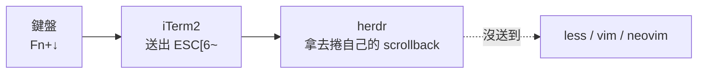
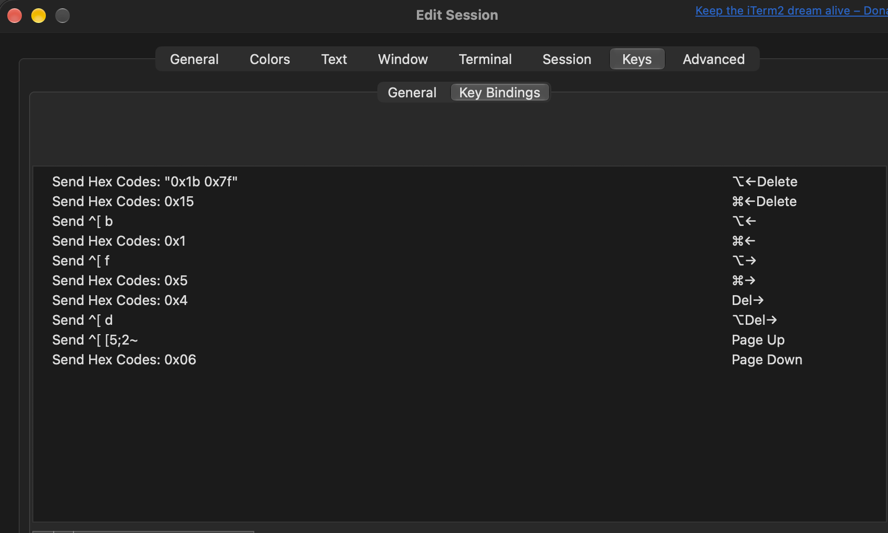
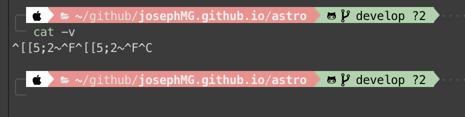

最近我把終端機多工器從 tmux 換成 [herdr](https://herdr.dev/)（類似 tmux，但會辨識 pane 裡跑的 Coding Agent）。結果一用就踩坑：在 tmux 裡，neovim 和 `git diff` 按 `Fn+↓`（Mac 筆電的 PageDown）翻頁從來沒出過問題，**一換成 herdr，同樣的按鍵就完全不會翻頁了**。偏偏按 `space` 或 `b` 又正常，很怪。

設定我沒動、iTerm2 沒動、neovim 和 less 也沒動，唯一換掉的就是多工器，所以很明顯是 herdr 的問題，只是不知道它怎麼搞的。

終端機其實是一層包一層的：**iTerm2 → herdr → zsh → less**。按鍵壞掉，任何一層都有可能把它吃掉。這篇就是記錄我怎麼一層一層切開來查，最後在「攔截發生之前」的那一層把問題繞過去，讓 git（less）、vim、neovim 三個都能用同一組按鍵翻頁。

> [!NOTE]
> 文中的結果我會標三種來源：**實測**（我在 herdr pane 裡送按鍵、讀畫面確認過）、**手動按**（我在實體鍵盤上按，看結果）、**推測**（照文件或按鍵語意推出來的，沒有驗證）。

<!-- more -->

### TOC

---

## 一、環境

| 項目 | 版本 |
|---|---|
| 終端機 | iTerm2 3.7.6 |
| 多工器 | herdr 0.9.5 |
| pager | less 668（macOS 內建 `/usr/bin/less`） |
| vi | Homebrew vim 9.1（`/opt/homebrew/bin/vi`） |
| neovim | 0.12.5 |
| `TERM` | `xterm-256color` |

### 前情提要：herdr 的 CLI 可以從另一個 pane 操作 pane

後面好幾個測試都會用到 herdr 的這個功能，先簡單講一下。

herdr 除了畫面上的操作，還有一個 `herdr` 指令。在任何一個 herdr 的 pane 裡下指令，就能控制**別的** pane：在裡面執行指令、模擬按鍵、直接寫入字元，或讀出畫面上的文字。tmux 也有類似的 `send-keys`、`capture-pane`。

用法是開兩個 pane，一個當「被測試的」，一個當「下指令的」：

1. **pane A**：被測試的 pane，目前目錄要在某個 git repo 裡。
2. **pane B**：在這裡下 `herdr` 指令。先查出 pane A 的 ID（`$HERDR_WORKSPACE_ID` 是 herdr 在每個 pane 裡自動設好的環境變數，代表目前的 workspace，不用自己設）：

   ```bash
   herdr pane list --workspace "$HERDR_WORKSPACE_ID"
   ```

   回傳的 JSON 裡有每個 pane 的 `pane_id`，例如 `w1:p2`。也可以直接在 pane B 開一個新的 pane 當作 pane A，回傳結果裡就有它的 ID：

   ```bash
   herdr pane split --current --direction right --cwd "$PWD" --no-focus
   ```

3. 之後在 pane B 執行的指令裡，`<pane>` 都換成 pane A 的 ID：

   | 指令 | 作用 |
   |---|---|
   | `herdr pane run <pane> "git diff HEAD~3"` | 在 pane A 執行指令 |
   | `herdr pane send-keys <pane> space` | 模擬在 pane A 按下 `space`，會經過 herdr 的按鍵處理 |
   | `herdr pane send-text <pane> $'\e[6~'` | 把字元原封不動寫進 pane A，不經過 herdr 的按鍵處理 |
   | `herdr pane read <pane> --source visible --lines 3` | 讀出 pane A 畫面最後幾行，用來看 less 的狀態列 |

這些指令要在 herdr 的 pane 裡執行，herdr 才知道要控制哪個 session。

這樣做的好處是可以精準控制「送了什麼」，還能把結果讀成文字。但有一個限制：**這些按鍵是從 herdr 內部送出的，完全不會經過 iTerm2**。所以它只能證明「herdr → less」這一段沒問題，模擬不了實體鍵盤。這也是為什麼第四節最後還是要靠人在鍵盤上按。

## 二、症狀

先補一句：`git diff` 的內容超過一個畫面時，git 會用 less 來分頁顯示，所以翻頁其實是 less 在處理。

在 herdr 的 pane 裡：

- `git diff`、`git show`、`git log -p` 開啟 less 後，按 `Fn+↓`（PageDown）沒反應，`Fn+↑`（PageUp）也一樣。
- `space`（下一頁）、`b`（上一頁）、`f` 都正常。
- 同樣的指令在 **herdr 外面**的 iTerm2 分頁裡，PageDown 完全正常。
- 換成 herdr 之前，在 **tmux** 裡 neovim、git 都能用 PageDown 翻頁。

## 三、先排除掉的東西

查問題我習慣先把最容易的幾個猜測排掉，一個一個來。

### 1. git 用的 pager 是不是 less？

先確認一下到底是誰在顯示：

```bash
echo "GIT_PAGER=${GIT_PAGER-<unset>} PAGER=${PAGER-<unset>} LESS=${LESS-<unset>}"
git config --show-origin --get-all core.pager
git var GIT_PAGER
```

```text
GIT_PAGER=<unset> PAGER=less LESS=--chop-long-lines --ignore-case --jump-target=4 --LONG-PROMPT --no-init --quit-if-one-screen --RAW-CONTROL-CHARS
less
```

- `core.pager` 沒設，git 用的就是 `less`。我也沒裝 `delta`、`bat` 這類會接管 pager 的工具。
- `LESS` 是 zsh 框架 [zim](https://zimfw.sh/) 的 `utility` 模組設的。裡面有兩個參數要留意：`--quit-if-one-screen`（內容一頁放得下就直接結束）、`--no-init`（不切換到全螢幕畫面）。它們跟這次的問題無關，但後面講替代方案的時候會用到。

### 2. herdr 有沒有把 PageDown 綁成快捷鍵？

接著懷疑 herdr 是不是把 PageDown 拿去綁別的功能。`herdr --default-config` 印出來的預設設定裡，動作快捷鍵都要先按 prefix（預設 `ctrl+b`），例如 `prefix+j`、`prefix+c`。我再用 `grep -iE 'page|scroll'` 在整份設定檔裡找，只找到 `edit_scrollback`、`mouse_scroll_lines`、`pane_scrollbars`、`scrollback_limit_bytes`，**沒有任何跟 PageUp／PageDown 相關的選項**。

所以當下我覺得 herdr 不會攔單鍵。不過後面會發現，這個判斷是錯的。

### 3. less 在 herdr pane 裡能不能翻頁？（實測）

那會不會是 less 在 herdr 裡本身就壞了？用前面介紹的 herdr CLI，在 pane B 讓 pane A 跑 `git diff HEAD~3`，再模擬按下 `space`、`f`。每按一次，就看一次 less 畫面最底下的狀態列：

```bash
herdr pane run <pane> "git diff HEAD~3"
herdr pane send-keys <pane> space
herdr pane send-keys <pane> f
```

```text
一開始：         lines 1-64
按下 space 後：  lines 65-128
按下 f 後：      lines 129-192
```

`lines 1-64` 是 less 狀態列顯示的「目前顯示第 1 到 64 行」（`LESS` 裡的 `--LONG-PROMPT` 讓狀態列顯示得這麼詳細）。每按一次就剛好前進一整頁，每頁幾行取決於 pane 的高度。所以 less 在 herdr 裡翻頁完全正常，問題不在 less。

順帶一提，`herdr pane send-keys <pane> pagedown` 會回 `unsupported key pagedown`，herdr 的 CLI 不認得這個按鍵名稱，所以我改用下一個方法。

### 4. 繞過鍵盤，直接把 PageDown 序列寫進 pane（實測）

PageDown 在終端機裡其實是一串跳脫序列 `ESC [ 6 ~`。既然 `send-keys` 不認得，那就直接把這串字元寫進 pane，用的就是前面表格裡的 `send-text`：

```bash
herdr pane run <pane> "git diff HEAD~3"
herdr pane send-text <pane> $'\e[6~'
```

```text
一開始：          lines 1-64
送出 ESC[6~ 後：  lines 65-128
```

**less 收到序列就會翻頁。** 所以「herdr → pane → less」這段傳送沒問題，問題出在「鍵盤 → herdr」這段，也就是 herdr 的輸入層，或是更前面的 iTerm2。

### 5. iTerm2 有沒有自訂 PageDown？

最後看一下是不是我自己在 iTerm2 裡亂改過：

```bash
defaults read com.googlecode.iterm2 | grep -iE '0xf72d|0xf72c|PageDown|Page Down'
```

沒有任何輸出，iTerm2 用的是內建預設的按鍵對應，沒被我動過。

## 四、用 `cat -v` 切層

到這裡有個麻煩：前面都是用程式送按鍵，會繞過 iTerm2，模擬不了實體鍵盤。最後一步只能靠人在鍵盤上按。

這時候 `cat -v` 就很好用，它會把收到的控制字元印成看得見的形式，例如 PageDown 會顯示成 `^[[6~`。如果按下去畫面上什麼都沒有，就代表這個按鍵**根本沒送到 pane 裡的程式**。

| 在哪裡跑 `cat -v` | 按鍵 | 結果（手動按） |
|---|---|---|
| herdr 的 pane | `Fn+↓` | 什麼都沒出現 |
| herdr 的 pane | `Shift+Fn+↓` | 什麼都沒出現 |
| herdr 的 pane | `Ctrl+Fn+↓` 等加修飾鍵的組合 | 都沒出現 |
| herdr 外面的 iTerm2 分頁 | `Fn+↓` | 正常出現 PageDown 的序列 |

答案出來了：**iTerm2 有正常送出 PageDown，是 herdr 把它吃掉的。**



## 五、原因：herdr 把沒有修飾鍵的 PageUp／PageDown 拿去捲 scrollback

這就是為什麼 tmux 好好的，換成 herdr 就壞掉。tmux 預設只有先按 prefix 再按 PageUp 才會進入 copy mode 捲動畫面，單按 PageUp／PageDown 會原樣交給 pane 裡的程式；herdr 則是不用按 prefix 就直接攔下來，自己拿去捲 scrollback。

這個結論我沒有去讀 herdr 的原始碼，依據是 herdr 的 GitHub Discussions：

- [#1284](https://github.com/herdrdev/herdr/discussions/1284)：單按 PageUp／PageDown 會以一整頁為單位捲動目前 pane 的 scrollback；Shift+PageUp／PageDown 則刻意轉給 pane 裡的程式。
- [#1705「Option to change pageup and pagedown keybinding」](https://github.com/herdrdev/herdr/discussions/1705)：有人回報一樣的問題，提議新增 `keys.page_scroll_up`／`keys.page_scroll_down` 設定。
  - 有人在 0.9.3 測試後寫道：「Modified page keys still reach the app (only PageUp/PageDown with no modifiers are taken).」
  - 另一個人在自己的 fork 實作了這個設定，但因為貢獻政策的關係沒有送回主專案。
  - 寫這篇的時候，討論串**沒有維護者回應**，最新正式版仍是 0.9.5，**沒有設定可以關掉這個行為**。

> [!WARNING]
> #1705 說「加了修飾鍵的 page 鍵會送到程式」，但在我的 Mac 上，`Shift+Fn+↓`、`Ctrl+Fn+↓` 在 `cat -v` 裡都沒出現。原因我沒查清楚。我的推測是：`Shift+PageDown` 被 iTerm2 自己拿去捲畫面；`Ctrl+↑`／`Ctrl+↓` 是 macOS 的 Mission Control 快捷鍵，`Ctrl+Fn+↓` 也可能被系統先攔走。這兩點都**沒有驗證**。

所以想靠「加修飾鍵」讓按鍵穿過 herdr，在 Mac 上這條路走不通。

## 六、修法：在 iTerm2（herdr 之前）換掉按鍵

既然 herdr 會攔 PageUp／PageDown，那就讓它**根本看不到** PageUp／PageDown。在 iTerm2 這一層，把 `Fn+↓`、`Fn+↑` 改成送出別的序列，herdr 不認得，就會原樣轉給 pane 裡的程式。

設定的地方：在跑 herdr 的 iTerm2 分頁按 `⌘I`（Session → Edit Session）→ **Keys** → **Key Bindings**，按 `+` 新增。在 Mac 筆電上按 `Fn+↓`、`Fn+↑` 錄製按鍵時，iTerm2 會直接顯示成 **Page Down**、**Page Up**。

> [!TIP]
> 一定要用 `⌘I` 改「**目前這個分頁**」的設定。我第一次是在 Settings → Profiles 裡改，結果改到的不是這個分頁實際用的 profile，在 herdr 裡 `cat -v` 按 `Fn+↓` 依然什麼都沒有，白查了一輪。

### 第一版：`Ctrl+F`／`ESC v`（後來改掉）

一開始我是這樣設的：

| 按鍵 | Action | 值 | 在 less 裡的意思 |
|---|---|---|---|
| `Fn+↓` | Send Hex Code | `0x06` | `Ctrl+F`：下一頁 |
| `Fn+↑` | Send Text with "vim" Special Chars | `\ev` | `ESC v`：上一頁 |

改完後在 herdr 裡 `cat -v`，依序按 `Fn+↓`、`Fn+↓`、`Fn+↑`、`Fn+↑`，畫面出現：

```text
^F^F^[v^[v
```

按鍵穿過 herdr 了。再把這兩個序列送給 `git log -p` 的 less 驗證（實測）：

```text
一開始：         lines 1-62
送出 ^F 後：     lines 63-124
送出 ESC v 後：  lines 1-62
```

git 可以翻頁了，結果我手動按（實體鍵盤）才發現：**neovim 壞掉了**。

原因是依 vim 系的按鍵語意推論的（我沒在 neovim 裡逐鍵重現）：`ESC v` 在 neovim 不是「上一頁」，而是「先按 Esc 回到 Normal 模式，再按 `v` 進入 Visual 模式」。所以每按一次 `Fn+↑`，就會開始選取文字，超煩。

### 最後的設定：`Ctrl+F`／Shift+PageUp

所以上一頁要換一個 less 和 vim 都吃的序列，最後是這樣：

| 按鍵 | Action | 值 |
|---|---|---|
| `Fn+↓` | Send Hex Code | `0x06`（`Ctrl+F`） |
| `Fn+↑` | Send Escape Sequence | Esc+ `[5;2~`（Shift+PageUp） |

設好之後，Key Bindings 的最後兩筆就是這兩個設定（前面幾筆是原本就有的 `⌥←`、`⌘←` 等游標移動設定，跟這次無關）：



less 預設不認得 Shift+PageUp，所以要用 `~/.lesskey` 教它：

```bash
printf '#command\n\\e[5;2~ back-screen\n' >| ~/.lesskey
```

檔案內容：

```text
#command
\e[5;2~ back-screen
```

less 668 啟動時會自動讀 `~/.lesskey`，不用另外編譯。

改完之後，在 herdr 的 pane 裡再跑一次 `cat -v`，依序按 `Fn+↑`、`Fn+↓`、`Fn+↑`、`Fn+↓`，最後按 `Ctrl+C` 結束：



`^[[5;2~` 是 Shift+PageUp，`^F` 是 `Ctrl+F`，最後的 `^C` 是結束 `cat` 時按的 `Ctrl+C`。修改前同樣的按法，畫面上什麼都不會出現；現在兩個鍵都穿過 herdr，送到了 pane 裡的程式。

手動按的結果：設好之後，**git、vi、neovim 三個都能用 `Fn+↓`／`Fn+↑` 翻頁。**

### 為什麼選這兩個鍵

| iTerm2 實際送出 | git／less 668 | vi（vim 9.1） | neovim 0.12.5 |
|---|---|---|---|
| `Fn+↓` → `Ctrl+F`（`0x06`） | 可以，原生：下一頁（實測） | 可以，原生：下一頁 | 可以，原生：下一頁 |
| `Fn+↑` → Shift+PageUp（`\e[5;2~`） | 要設定：預設不認得，靠 `~/.lesskey` 綁 `back-screen` | 可以，原生 `<S-PageUp>`：上一頁 | 可以，原生 `<S-PageUp>`：上一頁 |
| 第一版 `Fn+↑` → `ESC v` | 可以，原生：上一頁（實測） | 不行，推測同 neovim | 不行，變成 Esc＋`v`，進入 Visual 模式 |
| 原本的 PageDown（`\e[6~`） | 不行，被 herdr 攔 | 不行，被 herdr 攔 | 不行，被 herdr 攔 |

（沒標「實測」的欄位，都是我在實體鍵盤上手動按的結果。）

- **下一頁：** less 和 vim 系的按鍵表不一樣，`Ctrl+F` 是兩邊**唯一共通**、herdr 又不攔的「下一頁」。
- **上一頁：** 找不到共通鍵。`Ctrl+B` 在 vim 系是上一頁，但它剛好是 herdr 的 prefix，會衝突。所以改選 vim 系原生認得的 Shift+PageUp，再用 `~/.lesskey` 讓 less 也認得。
- **為什麼 Shift 組合鍵的問題不會碰到它：** 我實際按的是 `Fn+↑`，並不是 `Shift+Fn+↑`。是 iTerm2 照 Key Bindings 的設定，直接把 Shift+PageUp 的序列送出去，所以第五節懷疑的 iTerm2 捲動功能和 macOS 快捷鍵，根本沒機會碰到這個按鍵。再加上依 #1705 的說法，帶修飾鍵的 page 鍵 herdr 會轉給程式，實際結果也符合。

> [!NOTE]
> vim 能把 `\e[5;2~` 認成 `<S-PageUp>`，我猜是 vim 從 terminfo 查到的，這只是推論，但結果確實可用。另外 macOS 內建的 `/usr/bin/vi` 跟 Homebrew 的 vim 版本不同，我沒有另外測。

### 副作用（推測，未實測）

這組按鍵是綁在 iTerm2 的 profile 上，所以在 **shell 提示字元**按也會生效：

- `Fn+↓` 送出 `Ctrl+F`，zsh 預設是 `forward-char`，游標會往右移一格。
- `Fn+↑` 送出 Shift+PageUp，zsh 沒綁的話可能會打出 `~` 之類的字元。

在 shell 裡本來就很少按 PageUp／PageDown，我目前覺得可以接受。

## 七、其他替代方案（沒採用）

如果不想動 iTerm2 的按鍵，其實還有幾條路，不過我都沒實作：

- **`git config --global core.pager cat`**：乾脆不用 pager，整段輸出交給 herdr，用 herdr 自己的 scrollback 捲。代價是 less 的搜尋就沒了。
- **用 neovim 當 pager**：`git config --global core.pager "nvim -R -c 'set ft=git nomod' -"`。每次都要開 neovim 就算了，而且 neovim 一樣收不到 PageDown，問題只是換個地方。
- **`git config --global core.pager 'less -+F -+X --mouse'`**：把前面提到的 `--quit-if-one-screen` 和 `--no-init` 拿掉，改用滑鼠滾輪翻頁。herdr 預設會接管滑鼠（`mouse_capture = true`），less 收不收得到滾輪，我沒驗證。
- **等 herdr 支援**：#1705 如果被接受，就能直接把 page scroll 改綁別的鍵。

## 八、結語：終端機按鍵壞掉時的診斷順序

這次查下來，我自己整理的順序是這樣：

1. **先看 pager 設定**：`git var GIT_PAGER`、`$PAGER`、`$LESS`。先確認是誰在顯示、帶了什麼參數。
2. **直接注入序列**：用多工器的 CLI 把跳脫序列直接寫進 pane，也就是第三節第 4 點用的方法。herdr 是 `send-text`，tmux 對應的是 `send-keys -l`，做的事一樣。程式有反應，就代表問題在輸入端，不在程式。
3. **用 `cat -v` 在每一層比對**：在多工器裡、外各按一次，看序列在哪一層消失。
4. **修法放在攔截發生之前的那一層**：攔的人沒有開關，就讓它看不到原本的按鍵。

`cat -v` 是最便宜的工具，一行指令就能把「按鍵到底有沒有送到」看得清清楚楚。

## 參考資料

- [herdr discussion #1284](https://github.com/herdrdev/herdr/discussions/1284)
- [herdr discussion #1705：Option to change pageup and pagedown keybinding](https://github.com/herdrdev/herdr/discussions/1705)
- [herdr 鍵盤操作文件](https://herdr.dev/docs/preview/keyboard/)
