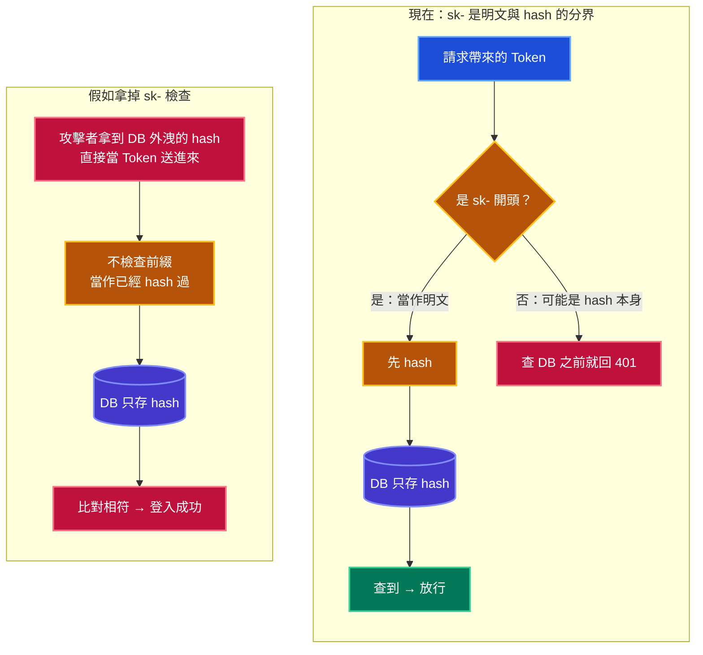
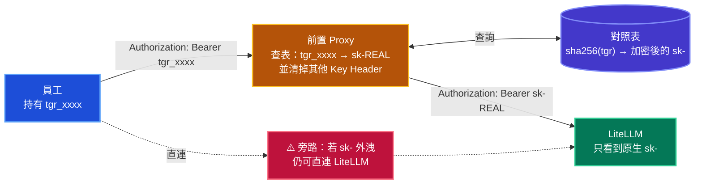

當我們用 LiteLLM 替每位員工各發一把 Virtual Key，用來限制模型白名單、設定預算、統計每個人的用量時，很自然會冒出一個念頭：

> 「發給員工的 Key 一律都是 `sk-` 開頭，看起來跟 OpenAI 的 Key 長得一模一樣。能不能換成自家的前綴，例如 `tgr_xxxxxxxx`？」

我們為此請 AI 做了一輪研究，讀 LiteLLM 原始碼、查文件與 GitHub Issue，並且讓每一個結論都再交給另一組 AI「審查者」嘗試推翻。結論有點出乎意料：**`sk-` 不只是外觀，而是 LiteLLM 用來區分「明文 Key」與「資料庫裡的雜湊值」的依據。** 想改前綴，成本遠比想像大，我們最後決定**先不做**。

> [!WARNING]
> **誠實聲明：本文的研究結論絕大部分屬於「AI 讀原始碼與文件」的成果，尚未在產線完整實測。** 文中會明確標示哪些是實際跑過的事實、哪些是 AI 研究（尚未實測）。實際驗證過的只有兩類：非 `sk-` Token 被擋下的 log，以及 Key 建立、封鎖、刪除、過期的行為（第六節）。

<!-- more -->

### TOC

---

## 一、起點：為什麼想換掉 `sk-`

我們的環境是在 Kubernetes 上替每位員工開一個開發環境容器，大家都透過 LiteLLM 打自架模型。一開始所有員工**共用同一把 Key**，後來發現這樣不行：

- 用量完全分不到個人頭上。
- 員工在自己的容器裡有 shell，**容器內的環境變數互相讀得到**，等於任何人都能拿走共用 Key。

所以決定改成「**每人一把 LiteLLM Virtual Key**」，由後台代為建立，管理員可以個別封鎖、刪除與查看用量。接著就有人問：既然要發給每個人了，Key 能不能換成自家前綴，好讓人一眼辨識是我們發的？

這篇就是為了回答這個問題。

---

## 二、LiteLLM 本身能不能改？

**結論：開源版（OSS）的 LiteLLM 原生做不到。**（AI 讀程式碼研究，我們檢查了當時部署的 `v1.105.1` 以及當時的 `main` 分支，兩者結論一致）

- **沒有任何設定可以改前綴。** 能調整的只有 Key 的「長度」，前綴本身沒有選項。
- **`sk-` 在「發 Key」與「驗證」兩頭都被寫死：**
  - 發 Key 時：自動產生的 Key 一律是 `sk-...` 格式；就算你自己指定 Key 內容，也必須以 `sk-` 開頭，否則直接回 `400`（讀原始碼的結論，未實測）。
  - 驗證時：請求帶來的 Token 如果不是 `sk-` 開頭，**在查資料庫之前就直接回 `401`**。這點我們在實際環境的 log 裡看過（見下方 NOTE）。
- **上游還沒有人處理。** 社群只有一個提議新增「自訂前綴」設定的 Feature Request（[#47270](https://github.com/BerriAI/litellm/issues/47270)），裡面也有其他開發者指出同樣兩處寫死的檢查。截至寫作時仍沒有維護者回應、也沒有 PR，已有一位外部貢獻者表示要接手。寫作時的最新版 `v1.109.1` 是否已支援，我們沒有驗證。

### 為什麼不能「直接把檢查拿掉」？

這是整篇最有意思的地方。LiteLLM 在資料庫裡**只存 Key 的雜湊值（hash）**，不存明文。那它怎麼知道請求送進來的字串，是「明文 Key」還是「別人從資料庫外洩的 hash」？

答案就是 **`sk-` 前綴**：

- 帶 `sk-` 的字串 → 當作明文 Key，先 hash 再去資料庫查。
- 不帶 `sk-` 的字串 → 當作可能是 hash 本身，一律拒絕。

如果把這個檢查拿掉，**資料庫裡洩漏的 hash 值本身就能直接拿來當憑證登入**。這個前綴同時還被用在判斷「這個字串是不是已經被遮罩過」（避免明文 Key 流進 log 或 Prometheus 標籤）、封鎖／解除封鎖 Key 等許多地方。所以它是整個專案的安全假設，不是單一處的字串檢查。



> [!NOTE]
> 一個小插曲（實測）：我們換憑證的過程中，有一個還沒重啟的舊 Pod 拿另一種格式的 Token 打 LiteLLM，log 裡就出現了 8 筆這樣的紀錄（Token 已遮罩），Pod 重啟後就沒再出現：
>
> ```text
> AssertionError: LiteLLM Virtual Key expected. Received=xxxx****8888, expected to start with 'sk-'.
> ```
>
> 也因為這樣，我們在部署前檢查裡加了一條：**LiteLLM 的 master key 必須以 `sk-` 開頭**。這是預防性的檢查，我們沒有實際試過非 `sk-` 的 master key 會怎樣。

---

## 三、想保留 Virtual Key 功能，只剩這幾條路

我們要的不只是「換個好看的字串」，而是要**完整保留 Virtual Key 的功能**：模型白名單、預算、用量統計、封鎖。AI 研究列出 8 種候選做法，再逐一請審查者嘗試推翻，整理如下（**以下可行性皆為 AI 研究，除特別註明外尚未實測**）：

| # | 做法 | 結論 | 授權 | 重點風險 |
| :--- | :--- | :--- | :--- | :--- |
| 1 | **前置 Proxy 用對照表換 Token**：對外發 `tgr_xxx`，Proxy 查表換成真正的 `sk-` 再轉給 LiteLLM | **可行（推薦）** | OSS | 多一個能還原明文 `sk-` 的秘密儲存處；可被旁路 |
| 2 | **Gateway 前綴互換**（`tg-X` ↔ `sk-X`） | 部分可行 | OSS | 只換外觀、安全性沒變；漏改任何一種 Header 就 401 |
| 3 | **`custom_auth` 回傳字串**，之後走原生驗證 | 可行（AI 驗證者在官方映像檔做過最小測試，只確認認證能通過；預算、用量紀錄等未測，另一位審查者判為部分可行） | **Enterprise** | 沒有授權用在產線違反條款；寫錯會鎖住或放行所有請求 |
| 4 | **APISIX Consumer 加 proxy-rewrite** | 照原樣不可行 | OSS | 設計上 Route 層已有 rewrite 時，Consumer 那份不會執行 |
| 5 | **`custom_auth` 自己組 `UserAPIKeyAuth`** | 部分可行 | 視為 Enterprise | 等於重寫半套驗證，每次升級都可能壞 |
| 6 | **Fork 改前綴** | 理論可行 | MIT（改核心） | `startswith("sk-")` 散落二十多處，漏一處就有安全風險 |
| 7 | **`/key/generate` 直接指定非 `sk-` 的值，或直接寫 DB** | **不可行** | OSS | 發 Key 回 400（讀原始碼，未實測）、使用回 401（log 實測） |
| 8 | **`custom_key_generate` 等 Hook** | **不可行** | OSS | Hook 跑在格式檢查之前，改了也會被擋 |

### 最被看好的做法：在前置 Proxy 做「Token 對照表」

核心想法很簡單：**LiteLLM 內部永遠只認 `sk-`，但員工手上拿的是我們自訂格式的 Token。** 中間由一個前置的 Proxy 負責翻譯：



這個做法的好處：

- **Virtual Key 的功能全部保留**（模型白名單、預算、用量），因為 LiteLLM 收到的就是它熟悉的原生 `sk-`。
- **不需要 Enterprise 授權。**
- **撤銷很簡單**：在 LiteLLM 把底下的 `sk-` 封鎖就立即生效，對照表晚一點清也不會讓 Key 繼續能用。

但它的代價與要注意的細節也不少（AI 研究，未實測）：

1. **多了一個「能還原明文 `sk-`」的秘密儲存處。** 對照表本身就成了新的攻擊面。研究中另外提出一個變體：用 `sk-` ＋ HMAC 推導來省掉對照表（未驗證），但這會讓 HMAC Secret 變成所有 Key 的根，且只是推論、沒有驗證過。
2. **Header 一定要清乾淨。** LiteLLM 會從好幾種 Header 讀 Key，其中某些的優先序還比 `Authorization` 高。如果不把其他 Header 清掉，持有自訂 Token 的人可以通過閘門，卻改用另一把 Key 來計費。
3. **旁路問題：這是最大的決策點。** 如果 LiteLLM 本身、或叢集內其他入口仍然能直接收 `sk-`，那自訂 Token 就只是「外觀」。要不要關掉旁路，是安全與便利之間的取捨，不是技術問題。
4. **「員工看不到 `sk-`」其實要確保員工的容器裡沒有任何共用的 `sk-`。** 否則員工在自己的 shell 裡就能翻到。
5. **預算超額的錯誤訊息仍會帶出 `sk-...abcd` 的遮罩片段**，UI 與 log 的顯示也還是 `sk-` 格式，無法完全隱藏。
6. **客戶端要分別驗證。** Claude Code 與 OpenCode 送 Key 的 Header 不一樣（`x-api-key` vs `Authorization`），整條路徑沒有跑過，這是需要實測才能確定的事。

### 為什麼 `custom_auth` 看起來很香，但我們沒選

`custom_auth` 是 LiteLLM 提供的自訂驗證入口，可以讓你把 `tg-X` 轉成 `sk-X` 後交回原生流程，**改動量最小**。但官方文件寫明它需要 **Enterprise 授權**。從原始碼看，開源版目前沒有真的設授權閘門（讀原始碼的推論，未實測），看起來像是疏漏，**但這很可能日後被補上**——拿一個沒有授權保證的功能撐產線，風險太高。

---

## 四、那乾脆換掉 LiteLLM？

既然 LiteLLM 前綴寫死，會不會別的 AI Gateway 比較自由？我們讓 AI 比較了 15 種開源與商用的替代方案，條件是：Key 格式能自訂、每把 Key 能限制模型與預算、能把 Claude Code 的 Anthropic `/v1/messages` 轉給 vLLM，以及遇到 Claude Code 的 Web Search 會怎樣。

> [!WARNING]
> 下表是 **AI 讀原始碼與文件的研究結果（以研究當時的版本為準），我們一個都沒有實測**。這類比較過期得很快，請以各專案最新文件為準。

| 方案（版本） | 授權 | 自訂 Key 格式 | 每把 Key 模型限制 | 預算／限流 | Anthropic → vLLM | Web Search | 評估 |
| :--- | :--- | :--- | :--- | :--- | :--- | :--- | :--- |
| **agentgateway** v1.7.0 | Apache-2.0（跨 replica 預算屬 Enterprise） | ✅ 任意字串（兩種模式皆可） | ✅ 要用 Standalone 設定（可用 Standalone Helm chart 部署在 K8s） | ✅ USD／Token 預算（事後扣，同樣要 Standalone 設定）＋本機限流 | ✅ 含 streaming | ⚠️ 預設丟掉、很可能回 400；可用 conditional＋callout 自己查 SearXNG | 最佳（有條件） |
| **Apache APISIX** ≥3.17.0 | Apache-2.0 | ✅ 任意字串 | ❌ 要自己組 | ⚠️ 只有 Token 限流，沒有金額預算 | ✅ | ❌ 默默失效 | 可行 |
| **Higress** v2.2.5 | Apache-2.0 | ✅ 任意字串 | ⚠️ 每個模型一條 Route | ⚠️ Token 配額，沒有金額預算 | ✅ | ❌ 400 或默默失效 | 可行 |
| **AxonHub** v1.0.0-beta11 | Apache-2.0＋LGPL-3.0 | ⚠️ 只能改整台共用前綴 | ✅ | ✅ 請求數／Token／金額配額 | ✅ | ❌ 默默失效 | 可行（前綴夠用的話） |
| **GPUStack** v2.3.0 | Apache-2.0（配額、計費屬 Enterprise） | ✅ 任意字串 | ✅ | ❌ OSS 沒有 | ⚠️ 外接 vLLM 未驗證 | ❌ 默默失效或 4xx | 可行但不划算 |
| **Bifrost** v2.4.0 | Apache-2.0 | ❌ 寫死 `sk-bf-` | ✅ | ✅ | ✅ | ⚠️ 要另接 MCP | 不解決 Key 格式 |
| **GoModel** v0.2.1 | MIT | ❌ 寫死 `sk_gom_` | ✅ | ✅ | ✅ | ❌ 直接回 400 | 不解決 Key 格式 |
| **Kong** 3.9.4（最後 OSS 版） | Apache-2.0 / Enterprise | ✅ 任意字串 | ⚠️ 部分 | ❌ 依 Token／金額限流屬 Enterprise | ❌ OSS 沒有 | ❌ | 弱 |
| **Envoy AI Gateway** v1.2.0 | Apache-2.0 | ✅ 任意字串 | ❌ 要靠 extAuth | ⚠️ 只有配額 | ✅ | ❌ 默默失效 | 弱 |
| **new-api** | AGPL-3.0 | ❌ 固定 48 碼 | ✅ | ✅ | ✅ | ❌ 400 或默默失效 | 弱 |
| **LLM Gateway** | AGPL＋EE | ❌ 寫死 `llmgtwy_` | ✅ | ⚠️ 有預算、沒有限流 | ⚠️ 接 vLLM 屬 Enterprise | — | 弱 |
| **claude-relay-service** | MIT | ⚠️ 只能改前綴 | ❌ 只有黑名單 | ✅ | ⚠️ 只能走 vLLM 原生端點 | — | 弱 |
| **Portkey OSS** v1.15.2 | MIT（控制面不開源） | ❌ | ❌ | ❌ | ❌（2.0 還是 pre-release） | — | 不適合 |
| **TensorZero** | Apache-2.0 | ❌ 寫死 `sk-t0-` | ❌ | ⚠️ 只有限流 | ❌ | — | 不適合（已封存） |
| **Helicone** | GPL-3.0 | ❌ 寫死 `sk-helicone-` | ❌ | ❌ | ❌ | — | 不適合（已休眠） |

「默默失效」指 Gateway 把搜尋工具丟掉卻不報錯，模型照樣回答，可能編出看似有根據的搜尋結果，比直接回 400 更危險。

結論：同時滿足四個條件的，開源裡只有 **agentgateway 的 Standalone 模式**，而且它的 admin API 自己不做認證、預算是事後才扣（超支要等下一個請求才擋）。

這裡的「Standalone」指的是設定方式，不是不能上 K8s。agentgateway 有兩種設定方式：

- **Standalone**：自己讀一份 YAML（或 admin API 加資料庫）。每把 Key 的 `allowedModels` 和 `budgets` 只在這種設定裡有。官方另有 Standalone 的 Helm chart，一樣可以部署在 K8s 上。
- **Gateway API controller**：用 CRD 設定，由 controller 推給 agentgateway。開源版在轉換時會把每把 Key 的模型白名單和預算清空（讀原始碼確認）。Key 本身還是可以用任意字串，模型限制可以用 Key 的 metadata 搭配 authorization 規則自己組，但真正的預算只能用 Token 限流代替（推論，未實測）。

**最大的代價：替代方案都沒有[上一篇](/blog/fixing-claude-code-web-search-behind-litellm/)提到的 Claude Code Web Search 攔截**（表中 Web Search 那一欄）。唯一的例外是 agentgateway：它可以用條件式虛擬模型把 web_search 子請求挑出來，再用 callout 直接查 SearXNG、把結果寫進 prompt 交給 vLLM，不需要 LiteLLM（讀原始碼的推論，未實測，細節見上一篇的更新）。其他方案要保留搜尋，就得另外做 SearXNG MCP，或讓 Claude Code 的流量繼續走 LiteLLM。

換掉 LiteLLM 的隱形成本也很可觀：

- 後台發 Key 的整套 API 要重寫（每個方案 API 形狀都不同）。
- 既有的 `sk-` Key 要重發。
- 所有客戶端的端點與 Key Header 都要改。
- 存在 LiteLLM 資料庫裡的模型設定要搬家。
- K3s 上的部署設定要跟著改。

---

## 五、我們的結論：留在 LiteLLM，目前先不做

| 選項 | 我們的評估 |
| :--- | :--- |
| 修改 LiteLLM 讓它支援自訂前綴 | 原生做不到；Fork 維護成本高、風險大 |
| 買 Enterprise 用 `custom_auth` | 改動最小，但需要付費授權，目前沒必要 |
| **留在 LiteLLM ＋ 前置 Proxy 做 Token 對照表** | **真的要做時採用的方案** |
| 換 AI Gateway | 多數會失去 Web Search 攔截（agentgateway 可用設定補回，未實測），遷移成本遠高於收益 |

**最後的決定：先不做自訂前綴。** 理由很務實：

1. 自訂前綴只是**外觀**。真正有價值的「每人一把 Key、可封鎖、可計費」用原生 `sk-` 就已經達成了。
2. 想做到「真的更安全」需要連旁路一起處理，那是另一個層級的工程。
3. 要做的話，成本主要落在前置 Proxy 的改造，而不是 LiteLLM 本身。

如果你的需求只是「讓員工別以為這是 OpenAI 的 Key」，或「一眼認出 Key 是誰發的」，更簡單的做法是**善用 `key_alias`、`user_id` 與 metadata 去標註身分**，不必動 Key 的格式。

---

## 六、幾個實際踩過的點（實測）

除了上面的 AI 研究，我們在當時部署的 LiteLLM（升級前的 1.82.x 版）實際驗證過下列行為，供做「每人一把 Key」的人參考。升級到 `v1.105.1` 之後，我們只重新確認了其中兩點：Key 查 `/key/info` 回 `200`，以及封鎖後查自己回 `401`。

- 非管理員的 Key 用 `GET /key/info` 查自己，回 `200`。
- 剛建立的 Key，`blocked` 欄位是 `null`；Unblock 之後才變成 `false`。**判斷是否被封鎖時，只有 `blocked === true` 才拒絕。**
- 封鎖後查 `/key/info` 多半回 `401`，但**偶爾會回 `200` 且 `blocked: true`**（疑似多個 Worker 之間的快取不一致）；不過拿封鎖的 Key 去打模型**一律是 `401`**。
- 刪除後回 `401`；過期的 Key 回 `400`（`expired_key`）。
- 新 Key 的預算預設是 `null`；不帶 `models` 時回傳 `[]`，代表**全部模型都可用**。
- `/key/info` 在叢集內的延遲約 13 ms（p50）。
- 版本升級的小提醒：升級到 `v1.105.1` 之後，`/metrics` 預設改為需要認證，不帶 Key 會回 `401`（實測）。另外升級時資料庫 schema 會跟著變，我們的做法是升級後不直接降版；這是依官方升級說明採取的保守做法，我們沒有實際降版過。

---

## 七、小結：如果你也想換 Key 前綴

1. **先想清楚你要的是「外觀」還是「安全」。** 只要外觀，用 `key_alias` 與 metadata 標註身分就夠了。
2. **OSS 版 LiteLLM 無法原生自訂前綴**，因為 `sk-` 是它區分「明文」與「雜湊」的核心機制，不能直接拿掉。
3. **真的要做，最務實的是在 LiteLLM 前面放一個 Proxy 做 Token 對照表。** 但請務必處理好三件事：Header 清乾淨、對照表的保護、以及旁路。
4. **換 AI Gateway 的代價遠超想像**，尤其多數會失去 Claude Code 的 Web Search 攔截；agentgateway 看起來能用設定補回，但我們還沒實測。
5. **所有「AI 研究」的結論，都請在你自己的環境實測過再上線。** 我們這次很清楚地把「實測」與「AI 讀原始碼」區分開來，也建議你這麼做：開源專案更新很快，今天讀到的行為，下個版本可能就不一樣了。
